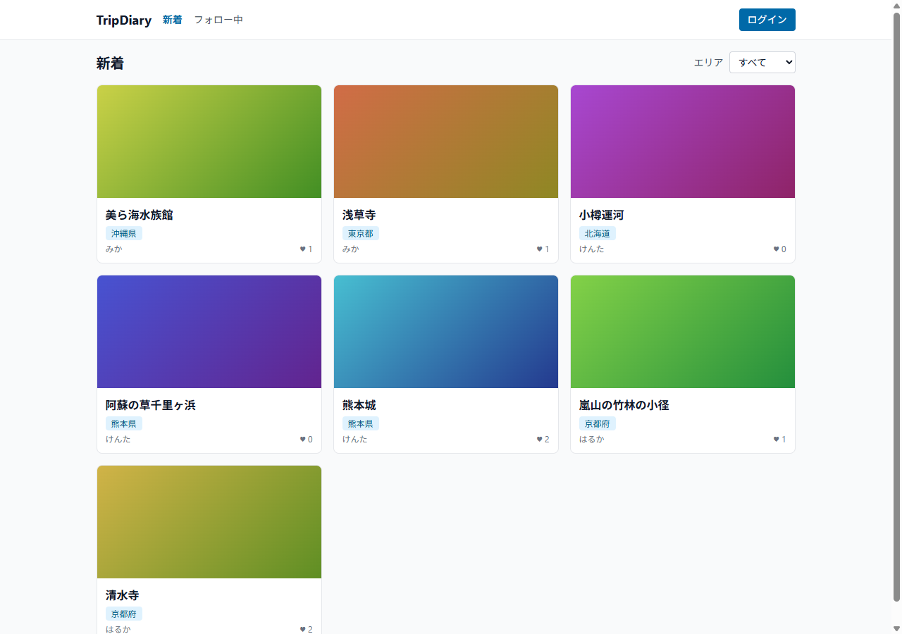
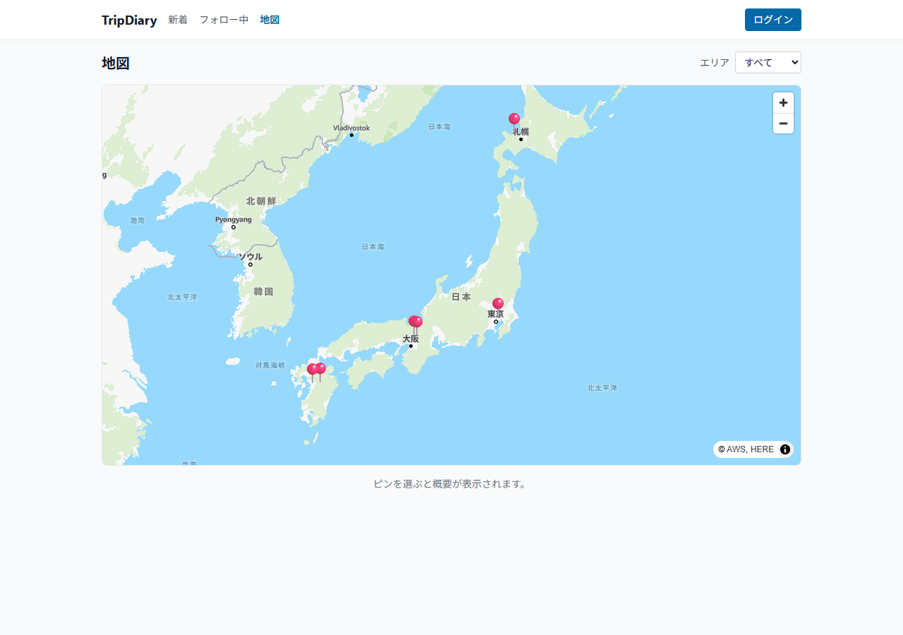
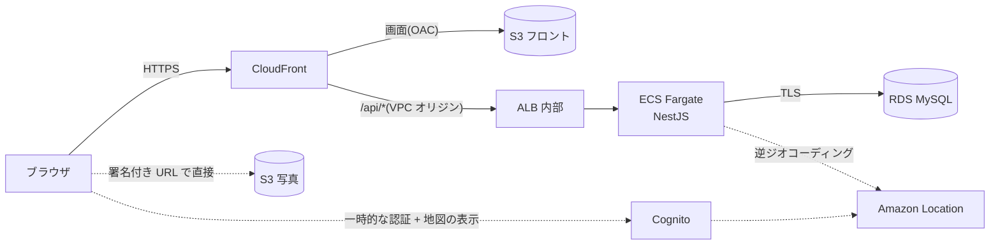

# TripDiary

旅行で訪れた場所(スポット)を、**写真・感想・住所・位置(地図)・エリアタグ**つきで記録し、公開範囲(公開 / フォロワー / 非公開)を選んで共有する旅行記録アプリです。他のユーザーの投稿への**いいね・コメント**、**フォロー**、「行きたい / 訪問済み」の**マイリスト**、地図で見返す機能があります。

Nuxt 4(SPA)+ NestJS 12 + MySQL を、**AWS(ECS Fargate・RDS・S3・CloudFront・Amazon Location Service)に、Terraform で構築**して公開します。コードは、GitHub Actions で、テストを通してからマージし、デプロイも GitHub Actions(OIDC)で行います。

| 新着一覧 | スポット詳細(写真・いいね・コメント・マイリスト) | マイリスト(スマホ幅) |
|---|---|---|
|  |  |  |

地図(Amazon Location Service。地名は日本語優先。ピンは、投稿の位置):



(AWS に構築した環境での、動作確認の画面です。)

## 目次

- [公開環境](#公開環境aws)
- [主な機能](#主な機能)
- [技術構成](#技術構成)
- [AWS の構成](#aws-の構成)
- [セキュリティ](#セキュリティ)
- [ローカルで動かす](#ローカルで動かす)
- [テスト](#テスト)
- [CI/CD](#cicd)
- [API](#api)
- [ディレクトリ構成](#ディレクトリ構成)
- [ドキュメント](#ドキュメント)
- [開発の進め方](#開発の進め方)

## 公開環境(AWS)

2026-11-20 から 2026-11-22 まで、AWS に公開しました。**確認が済んだため、環境(AWS のリソース、Terraform の state のバケットを含む)は、すべて削除しました。現在、URL は使えません**(使い捨ての運用。理由と費用は [docs/22_インフラ設計.md](docs/22_インフラ設計.md))。

- **費用の実績**: 約 $4(約 ¥600)。AWS の無料枠のクレジットで相殺され、請求は $0 の見込みです(開発中の確認を含む。公開は、約 44 時間)。
- 公開中の画面は、この README の画像のとおりです(上の画像は、AWS の環境で撮りました)。
- **作り直せます**: [docs/23_運用手順書.md](docs/23_運用手順書.md) の手順どおりに、何もない状態から、約 20 分で、同じ環境を作れます(作成 → デプロイ → デモデータ → 確認)。
- **デモ用のアカウント**(環境を作り直したときに、`scripts/seed-demo-data.mjs` で入れます。パスワードは共通):

| 表示名 | メールアドレス | パスワード |
|---|---|---|
| はるか | `demo-haruka@example.com` | `DemoPass123!` |
| けんた | `demo-kenta@example.com` | `DemoPass123!` |
| みか | `demo-mika@example.com` | `DemoPass123!` |

- デモ用のデータ(ユーザー 3 人、投稿 10 件、フォロー・いいね・コメント・マイリスト)で、公開範囲を確認できます(フォロワー限定の投稿が、フォローしている人にだけ見えます)。
- ローカルでも、動かせます(下の「ローカルで動かす」)。

## 主な機能

機能の一覧と状態は [docs/01_機能一覧.md](docs/01_機能一覧.md)、画面と URL は [docs/21_画面設計.md](docs/21_画面設計.md)。

| 分類 | できること |
|---|---|
| 認証 | 新規登録・ログイン・ログアウト。リロードしても、ログインが続く(アクセストークン + HttpOnly Cookie のリフレッシュトークン) |
| 投稿 | 場所名・感想・**写真(最大 20 枚)**・住所・**位置(地図)**・エリアタグ(都道府県。1〜3 個)・公開範囲の、登録・編集・削除 |
| 写真 | 手元の写真を選ぶと、ブラウザ側で縮小(長辺 1600px の JPEG。撮影場所などの情報は削除)し、S3 へ直接アップロード。詳細でギャラリー、一覧のカードで代表の写真 |
| 位置・住所 | **地図をタップしてピンを置き、ドラッグで微調整**。**「現在地から入力」で、位置と住所を自動入力**(住所は書き換えられる。許可されないときは手入力) |
| 地図 | 実際の地図(日本語表示)に、閲覧できる投稿をピンで表示。ピン → 概要 → 詳細。エリアで絞り込み。詳細にも、位置の小さな地図 |
| 公開範囲 | 公開 / フォロワー限定 / 非公開。**見えない投稿は、存在自体を隠す**(404)。一覧・詳細・地図・マイリスト・プロフィールで、同じ規則 |
| 探索 | 新着一覧(「もっと見る」)、エリアタグでの絞り込み、同じエリアの「近くのスポット」 |
| 反応 | いいね(自分の投稿には不可)、コメント(古い順。投稿者とコメントした人が削除できる) |
| フォロー | フォロー / 解除、フォロー中の投稿一覧、プロフィール(投稿数・フォロー数・フォロワー数) |
| マイリスト | 「行きたい」「訪問済み」。自分の投稿は、自動で「訪問済み」 |
| 画面 | PC・スマホ幅の両方に対応(スマホは、下部のタブバー)。アクセシビリティ(WCAG A/AA)を、自動テストで確認 |

## 技術構成

| 領域 | 技術 |
|---|---|
| フロント | Nuxt 4(SPA、`ssr: false`)・Vue 3・Pinia・Tailwind CSS 4・MapLibre GL JS |
| バックエンド | NestJS 12(ESM)・Prisma 7(MariaDB アダプター)・class-validator・@nestjs/swagger(OpenAPI をコードから生成) |
| データベース | MySQL 8.4(開発: docker compose。本番: RDS) |
| 認証 | scrypt(パスワードのハッシュ)・JWT(アクセストークン 15 分)・リフレッシュトークン(HttpOnly Cookie・14 日・使い捨て・盗用の検知) |
| 画像 | S3(署名付き URL で、ブラウザが直接アップロード・取得) |
| 地図 | Amazon Location Service(Maps v2・Places の逆ジオコーディング)・Cognito(地図の表示用の一時的な認証) |
| テスト | Vitest・Supertest・Vue Test Utils・Playwright・axe-core |
| インフラ | Terraform(AWS)・ECS Fargate(ARM64)・ALB(内部)・RDS・S3・CloudFront・Secrets Manager・ECR・GitHub OIDC |
| CI/CD | GitHub Actions(CI: Lint・ビルド・テスト。デプロイ: 手動実行・OIDC) |
| 言語・実行環境 | TypeScript(strict)・Node.js 24 |

## AWS の構成



- **同一オリジン**: 画面(S3)と API(`/api/*`)を、同じ CloudFront のドメインで配信します(CORS が不要で、Cookie がそのまま動く)。
- **NAT Gateway を使わない**(固定費が大きいため): Fargate はパブリックサブネットに置いて公開 IP を付けますが、受信は ALB のセキュリティグループからだけです。ALB と RDS は、プライベートサブネット(インターネットへのルートなし)です。
- **使い捨ての運用**: 動かしている間は、1 時間あたり約 $0.085(約 ¥13)。1 週間つけっぱなしで約 $14。使わないときは、`terraform destroy` で消します(「止める」では、ALB と RDS の課金が続くため)。予算のアラート(月 $20・$25)をメールで受け取ります。
- 詳しくは [docs/22_インフラ設計.md](docs/22_インフラ設計.md)(構成図・セキュリティグループ・費用・段階的な構築・実機での確認の記録)、[infra/README.md](infra/README.md)(Terraform の手順)。

## セキュリティ

| 観点 | 対策 |
|---|---|
| 認証 | パスワードは scrypt でハッシュ化。アクセストークンは短寿命(15 分)。リフレッシュトークンは、HttpOnly・Secure・SameSite=Strict の Cookie で、DB にはハッシュだけを保存。使うたびに作り直し(ローテーション)、使用済みが再び使われたら、盗用とみなして全トークンを失効 |
| 総当たりへの備え | ログインの失敗を、メールアドレスごと(15 分間で 10 回)・IP ごと(50 回)で数え、超えたら、**正しいパスワードでも** 429。未登録のメールアドレスも同じに扱う(アカウントの有無を知らせない)。登録も、IP ごとに制限 |
| 認可 | 公開範囲は、API 側で判定(画面の出し分けだけに頼らない)。見えない投稿は 404。他人の投稿の変更は 403 |
| 入力・出力 | 入力は、許可した項目だけ受け付け(whitelist)、型・長さ・範囲を検証。コメントや投稿の本文は、HTML として解釈せず、文字として表示(XSS 対策。テストで確認) |
| 写真 | S3 は非公開。署名付き URL は短寿命で、種類と大きさを署名に含める(別の種類・大きさ・改ざん・キーの書き換えは、S3 が 403)。アップロード後に、**実際の大きさ・形式を、API が確認**してから表示。公開範囲は、URL の発行時に確認。撮影場所などの情報(EXIF)は、縮小のときに削除 |
| 通信 | HTTPS のみ(HTTP は 301)・HSTS。DB への接続は TLS(**サーバーの証明書を、AWS 公式の CA で検証**。RDS 側も TLS でない接続を拒否) |
| ブラウザの制限 | CSP(許可した接続先・読み込みだけ)・X-Frame-Options・X-Content-Type-Options・Referrer-Policy・Permissions-Policy |
| ネットワーク | ALB・RDS は、インターネットから到達できない。アプリは、ALB からの受信だけ。DB は、アプリからの受信だけ |
| 秘密情報 | DB のパスワードは、RDS が生成して Secrets Manager に保管(Terraform の state に入らない)。リポジトリには、秘密情報・アカウント ID を置かない |
| AWS の権限 | 最小権限(タスクの実行ロール・タスクロール・デプロイ用ロールを、操作・リソースごとに絞る)。デプロイは、GitHub OIDC(長期のアクセスキーなし)で、`main` ブランチだけが引き受けられる |
| 地図 | ブラウザに渡す一時的な認証情報は、**地図の表示だけ**の権限。住所の取得(逆ジオコーディング)は、ブラウザではなく、ログイン済みのユーザーに限って、バックエンドが呼ぶ |

## ローカルで動かす

必要なもの: Node.js 24、Docker(Docker Desktop など)

```bash
# 1. 設定ファイルを用意する(.env はコミットしない)
cp .env.example .env            # docker compose 用(DB の名前・パスワード)
cp .env.example backend/.env    # バックエンド用(DATABASE_URL・JWT_SECRET・S3 など)
# backend/.env の JWT_SECRET を、長いランダム文字列に変える
#   node -e "console.log(require('crypto').randomBytes(48).toString('base64url'))"

# 2. DB と、写真の置き場(S3 互換のサーバー)を起動する(初回は、E2E 用 DB と Prisma の shadow DB の権限も作られる)
docker compose up -d db s3

# 3. バックエンド(http://localhost:3000、API 仕様書 http://localhost:3000/api/docs)
cd backend
npm install
npx prisma migrate deploy       # テーブルを作る
npm run start:dev

# 4. フロント(別のターミナル。http://localhost:5173)
cd frontend
npm install
npm run dev
```

ブラウザで http://localhost:5173 を開き、「新規登録」からユーザーを作ると使えます。

- **地図**: 設定なし(ローカル・CI)では、地図の絵のない背景になります(AWS に接続せず、ピン・クリック・ドラッグだけを試せます)。実際の地図を出すには、ビルドのときに `NUXT_PUBLIC_MAP_IDENTITY_POOL_ID`(Cognito の ID プール)を指定します([frontend/README.md](frontend/README.md))。
- **住所の自動入力**(「現在地から入力」)は、バックエンドが Amazon Location を呼ぶため、AWS の認証情報が要ります(ローカルでは、手入力か、地図のタップだけで使えます)。
- デモ用のデータを入れる: `node scripts/seed-demo-data.mjs http://localhost:3000`
- 既存の DB を使い回している場合: `docker compose` の初期化スクリプトは、DB を初めて作るときにしか動きません。E2E 用 DB と shadow DB の権限は、[docs/20_設計書.md](docs/20_設計書.md) の手順で、一度だけ作成してください。

## テスト

「テストが、本当に失敗を検出できるか」まで確かめる方針です(機能の PR ごとに、コードを意図的に壊して、対応するテストが失敗することを確認してから、戻します)。

| 種類 | コマンド | 件数 | 内容 |
|---|---|---|---|
| バックエンド単体 | `cd backend && npm test` | 58 | 純粋なロジック(パスワード・検証・回数の制限・住所の整形・TLS の設定など) |
| バックエンド結合 | `cd backend && npm run test:e2e` | 213 | 実際の MySQL と S3 互換のサーバーに対して、API の挙動(権限・公開範囲・競合・写真・地図・回数の制限・プロキシの後ろの IP)を確認 |
| フロント単体 | `cd frontend && npm test` | 97 | 画面の部品・ストア・計算(Vitest + Vue Test Utils) |
| E2E | `cd e2e && npm install && npx playwright install chromium && npm test` | 122 | 実際のブラウザで、主要な流れ・セキュリティ・アクセシビリティ(axe)・スマホ幅・地図・写真 |

- E2E は、専用の DB(`tripdiary_e2e`)・ポート(3100 / 5174)・バケットを使うので、開発サーバーを起動したままでも実行できます。ユーザーごとに別のデータを作るので、並列に実行できます。詳しくは [e2e/README.md](e2e/README.md)。
- Lint: バックエンドは `npm run lint`(oxlint)、フロントは `npm run lint`(ESLint)。型検査: フロントは `npm run typecheck`。
- フロントの Vitest は、Windows では Git Bash ではなく PowerShell から実行してください(Git Bash では、起動に失敗することがあります)。
- 方針の詳細: [docs/20_設計書.md](docs/20_設計書.md) の「テストの方針」。

## CI/CD

**CI**(`main` への PR ごと。すべて成功しないとマージできません。[.github/workflows/ci.yml](.github/workflows/ci.yml)):

| ジョブ | 内容 |
|---|---|
| Backend | lint・ビルド・単体・結合(MySQL・S3 互換サーバーつき)・OpenAPI の差分チェック・**本番のイメージのビルドと起動確認** |
| Frontend | lint・型検査・単体・静的出力(generate) |
| E2E | Playwright(MySQL・S3 互換サーバーつき。失敗時はレポートを保存) |

**デプロイ**(手動実行・`main` だけ・同時に 1 つ。[.github/workflows/deploy.yml](.github/workflows/deploy.yml)): ARM ランナーでイメージをビルドして ECR へ(タグは git の SHA)→ タスク定義の更新 → **マイグレーション(1 回限りの ECS タスク。失敗したらサービスを更新しない)** → サービスの更新 → フロントのビルド・S3 へ配置・CloudFront の無効化 → 疎通確認。AWS へは、GitHub OIDC で接続します(長期のアクセスキーなし)。

## API

コードから自動生成した OpenAPI を、[docs/api/openapi.json](docs/api/openapi.json) に置いています(手で編集しません。更新は `cd backend && npm run openapi`。CI が、古くなっていないかを確認します)。ローカルでは、Swagger UI(`/api/docs`)でも見られます(本番では、既定で無効)。

| 分類 | API |
|---|---|
| 認証 | `POST /api/auth/register`・`login`・`refresh`・`logout`、`GET /api/auth/me` |
| 投稿 | `POST /api/spots`、`GET /api/spots`(新着・エリア・フォロー中)、`GET /api/spots/map`(表示範囲)、`GET・PUT・DELETE /api/spots/{id}` |
| 写真 | `POST /api/spots/{id}/photos`(署名付き URL の発行)、`POST …/{photoId}/complete`(確認)、`DELETE …/{photoId}` |
| 反応 | `POST・DELETE /api/spots/{id}/like`、`GET・POST /api/spots/{id}/comments`、`DELETE …/{commentId}` |
| フォロー・プロフィール | `GET /api/users/{id}`、`POST・DELETE /api/users/{id}/follow` |
| マイリスト | `PUT・DELETE /api/spots/{id}/list`、`GET /api/me/list` |
| 住所 | `GET /api/geocode/reverse`(ログイン必須) |
| 状態 | `GET /api/health/live`(DB に依存しない)、`GET /api/health` |

エラーは、`{ code, message, fieldErrors? }` の形で統一しています。

## ディレクトリ構成

```
TripDiary/
├─ backend/     NestJS の REST API(Prisma・MySQL)。Dockerfile・マイグレーション・結合テスト
├─ frontend/    Nuxt 4(SPA)。画面・部品・ストア・単体テスト
├─ e2e/         Playwright(E2E・セキュリティ・アクセシビリティ・スマホ幅・地図・写真)
├─ infra/       Terraform(AWS)。層ごとのファイル(network・rds・ecs・cloudfront・location …)
├─ scripts/     運用の補助(デモデータの投入・GitHub の変数の設定・片付けの確認)
├─ docs/        要件・機能一覧・設計書・画面設計・インフラ設計・運用手順書・OpenAPI・画像
├─ docker/      開発用 MySQL の初期化スクリプト
├─ docker-compose.yml   開発用の MySQL と、S3 互換のサーバー
└─ .github/workflows/   CI(ci.yml)とデプロイ(deploy.yml)
```

## ドキュメント

[docs/INDEX.md](docs/INDEX.md) に、一覧と読み方があります。

| 知りたいこと | 読むもの |
|---|---|
| 何を作るか・制約 | [docs/00_要件定義書.md](docs/00_要件定義書.md) |
| 機能と進み具合 | [docs/01_機能一覧.md](docs/01_機能一覧.md) |
| 技術方針・認証・API・テストの方針 | [docs/20_設計書.md](docs/20_設計書.md) |
| 画面と遷移 | [docs/21_画面設計.md](docs/21_画面設計.md) |
| AWS の構成・費用・実機での確認の記録 | [docs/22_インフラ設計.md](docs/22_インフラ設計.md)、[infra/README.md](infra/README.md) |
| 環境の作り方・確認・消し方 | [docs/23_運用手順書.md](docs/23_運用手順書.md) |
| 各ディレクトリの使い方 | [backend/README.md](backend/README.md)・[frontend/README.md](frontend/README.md)・[e2e/README.md](e2e/README.md) |

## 開発の進め方

`main` へ直接 push せず、**ブランチ → PR → CI 成功 → マージ**で進めます(ブランチ保護で、CI の成功を必須にしています)。1 つの PR は、1 つの目的に絞り、**機能の PR には、必ずテストを含めます**。設計の判断・実機での確認の結果は、docs の改訂履歴に残しています。
