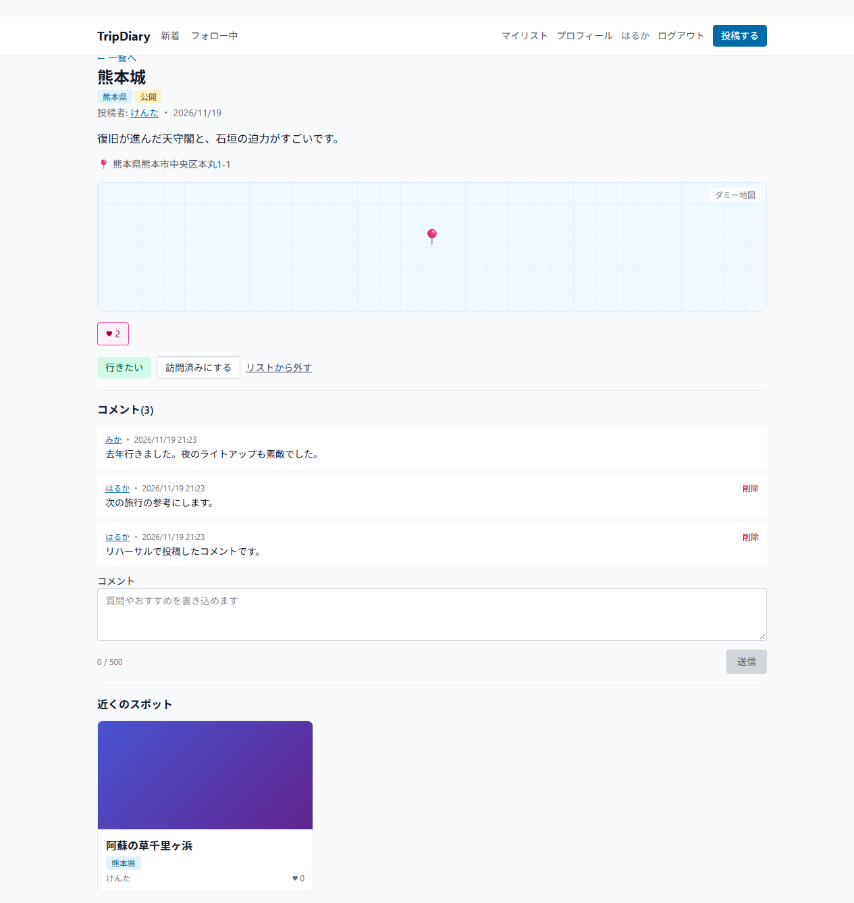
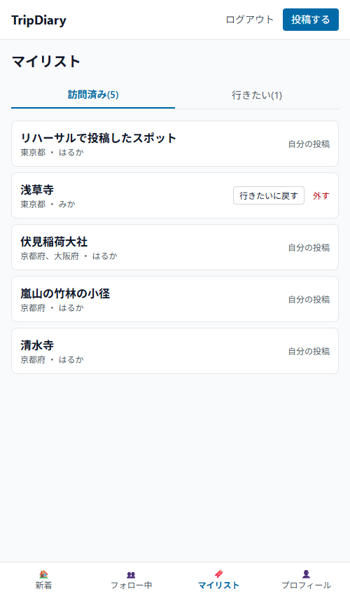
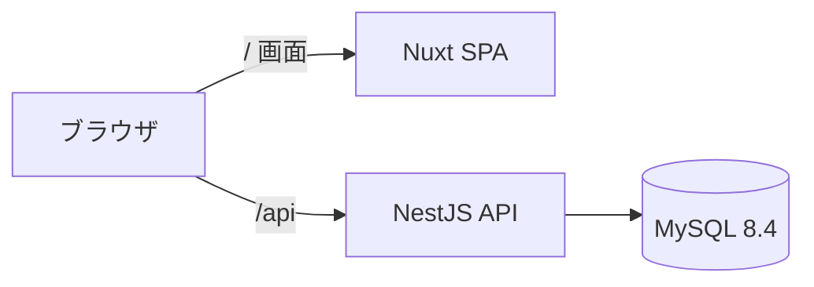

# TripDiary

旅行で訪れた場所(スポット)を、感想・住所・エリアタグつきで記録し、公開範囲(公開 / フォロワー / 非公開)を選んで共有する旅行記録アプリです。他のユーザーの投稿へのいいね・コメント、フォロー、「行きたい / 訪問済み」のマイリストも使えます。

> 状態: 主要機能(認証・投稿・いいね・コメント・フォロー・マイリスト・プロフィール)は実装済みです。写真アップロードと地図(F-04、F-16〜F-18)は AWS 上で実装するため、準備中です。AWS へのデプロイも準備中です(設計済み・段階的に構築中)。機能ごとの状態は [docs/01_機能一覧.md](docs/01_機能一覧.md) を参照してください。

## 主な機能

- 新規登録・ログイン(アクセストークン + HttpOnly Cookie のリフレッシュトークン)
- スポットの投稿・編集・削除、エリアタグ絞り込み、新着一覧(「もっと見る」のページング)
- 公開範囲(公開 / フォロワー / 非公開)。見えない投稿は存在自体を隠す(404)
- いいね、コメント、フォロー / フォロー中の投稿一覧、プロフィール
- マイリスト(行きたい / 訪問済み)、同じエリアの近くのスポット

画面と URL は [docs/21_画面設計.md](docs/21_画面設計.md) にあります。

| 新着一覧 | スポット詳細(いいね・コメント・マイリスト) | マイリスト(スマホ幅) |
|---|---|---|
|  |  |  |

(AWS に構築した環境での、動作確認の画面です。)

## 構成

```
TripDiary/
├─ backend/    NestJS 12 + Prisma(MySQL)の REST API
├─ frontend/   Nuxt 4(SPA)+ Pinia + Tailwind CSS
├─ e2e/        Playwright(E2E・セキュリティ・アクセシビリティ・スマホ幅)
├─ infra/      Terraform(AWS)※構築途中
├─ docs/       要件・機能一覧・設計書・画面設計・インフラ設計・OpenAPI
├─ docker/     開発用 MySQL の初期化スクリプト
└─ docker-compose.yml
```



開発時は Nuxt の開発サーバーが `/api` を NestJS へ転送し、ブラウザからは同一オリジンに見えます(本番も CloudFront で同じ形にする設計です。[docs/22_インフラ設計.md](docs/22_インフラ設計.md))。

## ローカルで動かす

必要なもの: Node.js 24、Docker(Docker Desktop など)

```bash
# 1. 設定ファイルを用意する(.env はコミットしない)
cp .env.example .env            # docker compose 用(DB の名前・パスワード)
cp .env.example backend/.env    # バックエンド用(DATABASE_URL と JWT_SECRET を使う)
# backend/.env の JWT_SECRET を、長いランダム文字列に変える
#   node -e "console.log(require('crypto').randomBytes(48).toString('base64url'))"

# 2. DB を起動する(初回は、E2E 用 DB と Prisma の shadow DB の権限も作られる)
docker compose up -d db

# 3. バックエンド(http://localhost:3000、API 仕様書 http://localhost:3000/api/docs)
cd backend
npm install
npx prisma migrate deploy       # テーブルを作る
npm run start:dev

# 4. フロント(別のターミナル。http://localhost:5173)
cd frontend
npm install
npm run dev
```

ブラウザで http://localhost:5173 を開き、「新規登録」からユーザーを作ると使えます。

### 既存の DB を使い回している場合
`docker compose` の初期化スクリプトは、DB を初めて作るときにしか動きません。E2E 用 DB と shadow DB の権限は、[docs/20_設計書.md](docs/20_設計書.md) の手順で一度だけ作成してください。

## テスト

| 種類 | コマンド | 内容 |
|---|---|---|
| バックエンド単体 | `cd backend && npm test` | 純粋なロジック |
| バックエンド結合(API + DB) | `cd backend && npm run test:e2e` | 実際の MySQL に対して、API の挙動(権限・公開範囲・競合)を確認 |
| フロント単体 | `cd frontend && npm test` | 画面・部品・ストアのテスト(Vitest + Vue Test Utils) |
| E2E | `cd e2e && npm install && npx playwright install chromium && npm test` | ブラウザで主要な流れ、セキュリティ、アクセシビリティ(axe)、スマホ幅 |

- E2E は専用の DB(`tripdiary_e2e`)とポート(3100 / 5174)を使うので、開発サーバーを起動したままでも実行できます。詳しくは [e2e/README.md](e2e/README.md)。
- Lint は、バックエンドが `npm run lint`(oxlint)、フロントが `npm run lint`(ESLint)です。型検査は、フロントが `npm run typecheck` です。
- フロントの Vitest は、Windows では Git Bash ではなく PowerShell から実行してください(Git Bash では起動に失敗することがあります)。

## CI(GitHub Actions)

`main` への PR ごとに、次の 3 ジョブが動き、すべて成功しないとマージできません([.github/workflows/ci.yml](.github/workflows/ci.yml))。

- Backend: lint、ビルド、単体、結合、OpenAPI の差分チェック
- Frontend: lint、型検査、単体、静的出力(generate)
- E2E: Playwright(失敗時はレポートを保存)

## API 仕様書

コードから自動生成した OpenAPI を [docs/api/openapi.json](docs/api/openapi.json) に置いています(手で編集しません。更新は `cd backend && npm run openapi`。CI が古くなっていないかを確認します)。起動中は Swagger UI(`/api/docs`)でも見られます。

## ドキュメント

[docs/INDEX.md](docs/INDEX.md) に一覧があります。

| 知りたいこと | 読むもの |
|---|---|
| 何を作るか・制約 | [docs/00_要件定義書.md](docs/00_要件定義書.md) |
| 機能と進み具合 | [docs/01_機能一覧.md](docs/01_機能一覧.md) |
| 技術方針・認証・テストの方針 | [docs/20_設計書.md](docs/20_設計書.md) |
| 画面と遷移 | [docs/21_画面設計.md](docs/21_画面設計.md) |
| AWS の構成・費用・運用の流れ | [docs/22_インフラ設計.md](docs/22_インフラ設計.md)、[infra/README.md](infra/README.md) |
| 環境の作り方・確認・消し方 | [docs/23_運用手順書.md](docs/23_運用手順書.md) |

## 開発の進め方

`main` へ直接 push せず、ブランチ → PR → CI 成功 → マージで進めます。機能の PR には必ずテストを含め、テストが本当に失敗を検出できるか(コードを意図的に壊して確認)も確かめています。

## デプロイ(準備中)

AWS(ECS Fargate + RDS MySQL + S3 + CloudFront、Terraform で構築)へ、期間を限って公開する計画です。公開 URL・デモ用アカウント・確認の手順は、デプロイ後にここへ追記します。
