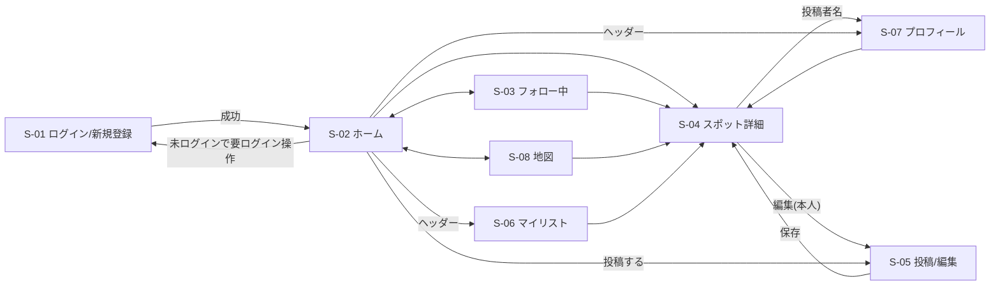

# TripDiary 画面設計

Nov 14, 2026 · @masatsumaple-creator · v0.6

画面 ID・機能 ID は `00_要件定義書.md`、`01_機能一覧.md` に従います。ここでは URL、画面間の遷移、画面ごとの要素、アクセス権を定めます。モック(Nuxt、ダミーデータ)はこの文書をもとに作ります。

## 1. 画面一覧

| ID | 画面 | URL | ログイン | 関連機能 |
|---|---|---|---|---|
| S-01 | ログイン/新規登録 | `/login` | 不要 | F-01, F-02 |
| S-02 | ホーム(新着一覧) | `/` | 不要 | F-11, F-12, F-07 |
| S-03 | フォロー中一覧 | `/following` | 必要 | F-10 |
| S-04 | スポット詳細 | `/spots/:id` | 不要(公開範囲に従う) | F-06, F-07, F-08, F-13, F-19 |
| S-05 | スポット投稿/編集 | `/spots/new`、`/spots/:id/edit` | 必要(編集は本人のみ) | F-03, F-04, F-05, F-17, F-18 |
| S-06 | マイリスト | `/me/list` | 必要 | F-13, F-14 |
| S-07 | プロフィール | `/users/:id` | 不要 | F-09, F-15 |
| S-08 | 地図 | `/map` | 不要 | F-16, F-12 |

## 2. 共通レイアウト

| 要素 | 内容 |
|---|---|
| ヘッダー | ロゴ(S-02 へ)、ログイン状態の表示。未ログインは「ログイン」、ログイン済みは「投稿する」とユーザーメニュー(プロフィール、マイリスト、ログアウト) |
| ナビゲーション | 新着(S-02)、フォロー中(S-03)、地図(S-08)。PC は上部、スマートフォンは下部のタブバー |
| 未ログインで S-03、S-05、S-06 を開いた場合 | S-01 へ移動し、ログイン後に元の画面へ戻る |

## 3. 画面遷移

## 4. 画面ごとの要素

### S-01 ログイン/新規登録
- ログインと新規登録をタブで切り替える
- 入力項目はメールアドレス、パスワード(新規登録は表示名も)
- エラーは項目の下に表示する

### S-02 ホーム(新着一覧)
- 上部にエリアタグ(都道府県)の絞り込みを置く
- 投稿カードは、写真 1 枚目、場所名、エリアタグ、投稿者、いいね数
- 20 件ずつ、「もっと見る」で追加読み込みする

### S-03 フォロー中一覧
- 表示は S-02 と同じカード形式
- フォロー中のユーザーがいない場合は、探索への案内を表示する

### S-04 スポット詳細
- 写真(複数枚を切り替え)、場所名、感想、住所、エリアタグ、公開範囲、投稿者
- 小地図(位置を示すピン)
- いいねボタンと件数
- 「行きたい」/「訪問済み」の登録ボタン
- コメント一覧と入力欄。自分のコメント(投稿者は自分の投稿上のすべてのコメント)に削除ボタン
- 本人のみ「編集」「削除」を表示する
- 「近くのスポット」: ページ下部に、同じエリアタグの他の投稿を最大 5 件、カード形式で新着順に表示する。該当がなければ表示しない

### S-05 スポット投稿/編集
- 場所名(必須)、感想、住所(最大 255 文字)、エリアタグ(1〜3 個)、公開範囲(公開/フォロワー限定/非公開)
- 写真は最大 20 枚。形式は JPEG/PNG/WebP、1 枚 5MB 以下
- 「現在地から入力」ボタン。許可されない場合や失敗した場合は手入力に切り替える
- 地図上で位置を指定・調整する

### S-06 マイリスト
- 「訪問済み」「行きたい」をタブで切り替える(タブに件数を表示)
- 各項目からスポット詳細へ移動できる。他人の投稿には、状態を変える操作と、リストから外す操作(自分の投稿は、自動で訪問済みで、変更・削除できない)

### S-07 プロフィール
- 表示名、投稿数、フォロー数、フォロワー数
- フォロー/解除ボタン(自分のプロフィールでは非表示)
- 閲覧可能な投稿の一覧

### S-08 地図
- 表示範囲内のスポットをピンで表示する(最大 100 件)
- ピンを選ぶと概要が出て、そこから S-04 へ移動する
- エリアタグで絞り込める

## 5. 実装の状況(モックから本実装へ)

最初は、API を呼ばない、ダミーデータの画面(モック)で、見た目と画面遷移を確認し、そのあと、画面ごとに、実際の API につなぎました。**すべての画面(S-01〜S-08)を、本実装に置き換え済み**です(ダミーの画面・データは削除しました)。画面ごとの状況は、次のとおりです。

### 本実装への置き換え状況

| 画面 | 状況 | 備考 |
|---|---|---|
| S-01 ログイン/新規登録 | 本実装 | 認証 API につながっている |
| S-02 ホーム | 本実装 | 新着一覧・エリア絞り込み・「もっと見る」(カーソル方式のページング) |
| S-04 スポット詳細 | 本実装(一部) | 場所名・感想・住所・エリア・公開範囲・投稿者(プロフィールへのリンク)・編集/削除・近くのスポット。**いいね**(件数と切り替え。自分の投稿には件数だけを出し、ボタンは出さない。未ログインで押すとログインへ移動して戻る。自動ではいいねしない)と**コメント**(古い順、20 件ずつ「もっと見る」、投稿、削除。削除ボタンは、本人と投稿者だけ。未ログインはログインへの案内。本文は HTML として解釈せず、文字として表示する)も本実装。**マイリストのボタン**(リストにないときは「行きたいに追加」「訪問済みに追加」。入っているときは、状態の表示と、「訪問済みにする」または「行きたいに戻す」、「リストから外す」。自分の投稿は、「訪問済み」の表示だけで、操作のボタンは出さない。未ログインで押すとログインへ移動して戻る。自動では追加しない)も本実装。**写真**(複数枚は、大きく 1 枚を表示し、前後のボタン・サムネイルで切り替える。1 枚だけなら、切り替えの部品は出さない。代替テキストは「<場所名>の写真 n/N」)も本実装。小地図は、位置があるときに実際の地図(動かせない。位置のピン)で表示 |
| S-05 スポット投稿/編集 | 本実装(一部) | **写真**: 「写真を追加」で、複数枚を選べる(JPEG・PNG・WebP、最大 20 枚)。選んだ画像は、その場で、長辺 1600px の JPEG に縮小する(撮影場所などの情報は削除される。縮小しても 5MB を超えるものは断る)。保存のとき、投稿を保存してから、外した写真の削除と、新しい写真の送信(1 枚ずつ。S3 の署名付き URL へ直接)を行う。送信に失敗した写真は残り、もう一度「保存」で、その写真だけを送り直す(投稿は重複しない)。先頭の写真が、一覧のカードの代表になる。**位置**: 地図をタップしてピンを置き、ドラッグで微調整できる。「現在地から入力」は、ブラウザの位置情報で、位置と住所(日本語。バックエンドが Amazon Location Service で調べる)を自動入力する(住所は書き換えられる。許可されない・取得できない・住所が見つからない・外部のサービスが失敗したときは、その旨を知らせ、地図のタップと住所の手入力に切り替えられる)。地図をタップ・ドラッグした位置の住所は、「この位置の住所を入力」を押したときだけ調べる(地図を動かすたびには、外部のサービスを呼ばない)。「位置情報を消す」で、位置を空にできる。「現在地から入力」は、ブラウザの位置情報で緯度・経度だけを入れる(住所は手入力) |
| S-07 プロフィール | 本実装 | 表示名、投稿数・フォロー数・フォロワー数、フォロー/解除ボタン(自分のプロフィールでは非表示。未ログインで押すと、ログイン後にこの画面へ戻る)、閲覧できる投稿の一覧(20 件ずつ、「もっと見る」)。フォロー・解除の後は、見られる投稿(フォロワー限定)と投稿数が変わるため、取り直す。ヘッダー・下部タブの「プロフィール」は、自分のプロフィールへ移動する |
| S-03 フォロー中 | 本実装 | フォローしている人の、見られる投稿だけを新着順で(20 件ずつ、「もっと見る」)。誰もフォローしていないときは、新着への案内を表示。未ログインはログイン画面へ移動して戻る |
| S-06 マイリスト | 本実装 | 「訪問済み」「行きたい」のタブ(件数つき)。**リストに入れた新しい順**で、20 件ずつ「もっと見る」。自分の投稿は自動で訪問済みに入り、行には「自分の投稿」と出て、操作のボタンはない。他人の投稿には、「訪問済みにする」(行きたいのタブ)または「行きたいに戻す」(訪問済みのタブ)と、「外す」。操作すると、その一覧から消え、件数を取り直す。空のときは、新着への案内。入れたあとに閲覧できなくなった投稿(非公開に変えられたなど)は、一覧にも件数にも出ない。未ログインはログインへ移動して戻る |
| S-08 地図 | 本実装 | 実際の地図(Amazon Location Service の地図を MapLibre GL JS で表示。**地名は、日本語を優先して表示する**)に、表示範囲内の、閲覧できる投稿をピンで表示する(最大 100 件。超えるときは、新しい 100 件にして、「拡大すると絞り込める」と知らせる)。地図を動かして止まると(0.3 秒後)、その範囲を取り直す。ピンを押すと概要(場所名・エリア・公開範囲)が出て、そこから詳細へ移動する。エリアで絞り込める。`?lat=…&lng=…&zoom=…` で、表示の位置を指定できる。ピンは、キーボードで操作できるボタン(読み上げの名前は場所名)。地図の絵を取れないときも、ピンと操作は使える(開発・テストは、AWS に接続せず、地図の絵のない背景) |

## 6. 決定事項
- [x] ログイン済みユーザーのヘッダー表示: 「マイリスト」「プロフィール」「表示名」「ログアウト」「投稿する」(スマホは、下部のタブバーに、新着・フォロー中・地図・マイリスト・プロフィール) (承認済み: 2026-11-20)
- [x] 投稿カードに表示する項目: 代表の写真(なければ色)・場所名・エリアタグ・公開範囲(公開以外)・投稿者・いいね数。感想の抜粋は出さない (承認済み: 2026-11-20)
- [x] コメント・いいねの未ログイン時の見せ方: いいねは、押すとログインへ移動し、ログイン後に元の画面へ戻る(自動ではいいねしない)。コメントは、ログインへの案内を出す (承認済み: 2026-11-20)

未決事項: なし。

## 7. 改訂履歴

| 版 | 日付 | 内容 |
|---|---|---|
| v0.1 | 2026-11-14 | 初版 |
| v0.2 | 2026-11-14 | S-04 に「近くのスポット」を追加 |
| v0.3 | 2026-11-14 | モックから本実装への置き換え状況を追記(S-01、S-02、S-04、S-05 を本実装、S-03、S-06、S-07、S-08 はモックのまま) |
| v0.4 | 2026-11-18 | S-07 プロフィールを本実装に。S-04 の投稿者をプロフィールへのリンクに。置き換えたモックの削除方針を追記 |
| v0.5 | 2026-11-18 | S-04 のいいね・コメント、S-03 フォロー中を本実装に。残るモックは S-06、S-08 |
| v0.6 | 2026-11-18 | S-06 マイリストと、S-04 のマイリストボタンを本実装に。残るモックは S-08 のみ |

| v0.7 | 2026-11-20 | S-08 地図を本実装に(実際の地図・表示範囲の取得・ピン・概要・エリア絞り込み)。S-04 の小地図を実際の地図に。S-05 の位置の指定(地図のタップ・ドラッグ)と、現在地からの住所の自動入力。ダミーの画面・データを削除 |
| v0.8 | 2026-11-20 | 地図の地名を、日本語優先で表示(標準のスタイルは英語名を優先するため、ブラウザ側で書き換える)。AWS 上で、実際の地図の表示・ピンの設置とドラッグ・現在地からの住所の入力を確認 |