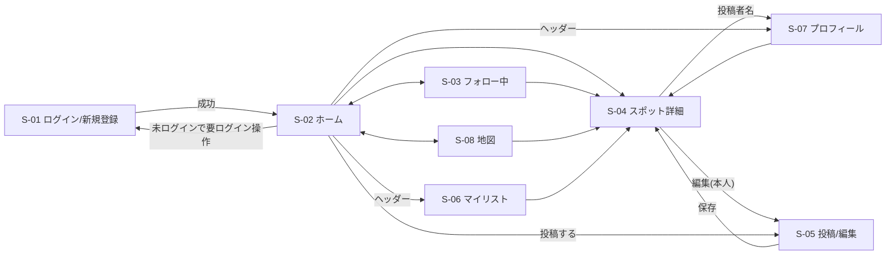

# TripDiary 画面設計

Nov 14, 2026 · @masatsumaple-creator · v0.1

画面 ID・機能 ID は `00_要件定義書.md`、`01_機能一覧.md` に従います。ここでは URL、画面間の遷移、画面ごとの要素、アクセス権を定めます。モック(Nuxt、ダミーデータ)はこの文書をもとに作ります。

## 1. 画面一覧

| ID | 画面 | URL | ログイン | 関連機能 |
|---|---|---|---|---|
| S-01 | ログイン/新規登録 | `/login` | 不要 | F-01, F-02 |
| S-02 | ホーム(新着一覧) | `/` | 不要 | F-11, F-12, F-07 |
| S-03 | フォロー中一覧 | `/following` | 必要 | F-10 |
| S-04 | スポット詳細 | `/spots/:id` | 不要(公開範囲に従う) | F-06, F-07, F-08, F-13 |
| S-05 | スポット投稿/編集 | `/spots/new`、`/spots/:id/edit` | 必要(編集は本人のみ) | F-03, F-04, F-05, F-17, F-18 |
| S-06 | マイリスト | `/me/list` | 必要 | F-13, F-14 |
| S-07 | プロフィール | `/users/:id` | 不要 | F-09, F-15 |
| S-08 | 地図 | `/map` | 不要 | F-16, F-12 |

## 2. 共通レイアウト

| 要素 | 内容 |
|---|---|
| ヘッダー | ロゴ(S-02 へ)、ログイン状態の表示。未ログインは「ログイン」、ログイン済みは「投稿する」とユーザーメニュー(プロフィール、マイリスト、ログアウト) |
| ナビゲーション | 新着(S-02)、フォロー中(S-03)、地図(S-08)。PC は上部、スマートフォンは下部のタブバー |
| 未ログインで S-03、S-05、S-06 を開いた場合 | S-01 へ移動し、ログイン後に元の画面へ戻る |

## 3. 画面遷移

## 4. 画面ごとの要素

### S-01 ログイン/新規登録
- ログインと新規登録をタブで切り替える
- 入力項目はメールアドレス、パスワード(新規登録は表示名も)
- エラーは項目の下に表示する

### S-02 ホーム(新着一覧)
- 上部にエリアタグ(都道府県)の絞り込みを置く
- 投稿カードは、写真 1 枚目、場所名、エリアタグ、投稿者、いいね数
- 20 件ずつ、「もっと見る」で追加読み込みする

### S-03 フォロー中一覧
- 表示は S-02 と同じカード形式
- フォロー中のユーザーがいない場合は、探索への案内を表示する

### S-04 スポット詳細
- 写真(複数枚を切り替え)、場所名、感想、住所、エリアタグ、公開範囲、投稿者
- 小地図(位置を示すピン)
- いいねボタンと件数
- 「行きたい」/「訪問済み」の登録ボタン
- コメント一覧と入力欄。自分のコメント(投稿者は自分の投稿上のすべてのコメント)に削除ボタン
- 本人のみ「編集」「削除」を表示する

### S-05 スポット投稿/編集
- 場所名(必須)、感想、住所(最大 255 文字)、エリアタグ(1〜3 個)、公開範囲(公開/フォロワー限定/非公開)
- 写真は最大 20 枚。形式は JPEG/PNG/WebP、1 枚 5MB 以下
- 「現在地から入力」ボタン。許可されない場合や失敗した場合は手入力に切り替える
- 地図上で位置を指定・調整する

### S-06 マイリスト
- 「訪問済み」「行きたい」をタブで切り替える
- 各項目からスポット詳細へ移動できる。「行きたい」には「訪問済みにする」と削除の操作

### S-07 プロフィール
- 表示名、投稿数、フォロー数、フォロワー数
- フォロー/解除ボタン(自分のプロフィールでは非表示)
- 閲覧可能な投稿の一覧

### S-08 地図
- 表示範囲内のスポットをピンで表示する(最大 100 件)
- ピンを選ぶと概要が出て、そこから S-04 へ移動する
- エリアタグで絞り込める

## 5. モックの方針

| 項目 | 方針 |
|---|---|
| 実装 | `frontend/` の Nuxt で作る。API は呼ばず、ダミーデータで表示する |
| 対象 | S-02、S-04、S-05、S-08 から着手し、続けて S-01、S-03、S-06、S-07 |
| 地図 | 地図ライブラリは使わず、ダミーの地図表示にする(MapLibre・Amazon Location は本実装で導入) |
| 確認 | 開発サーバーを起動し、ブラウザ(PC 幅とスマートフォン幅)で確認する |

## 6. 未決事項
- [ ] ログイン済みユーザーのヘッダー表示の詳細
- [ ] 投稿カードに表示する項目の最終決定(感想の抜粋を出すか)
- [ ] コメント・いいねの未ログイン時の見せ方

## 7. 改訂履歴

| 版 | 日付 | 内容 |
|---|---|---|
| v0.1 | 2026-11-14 | 初版 |
