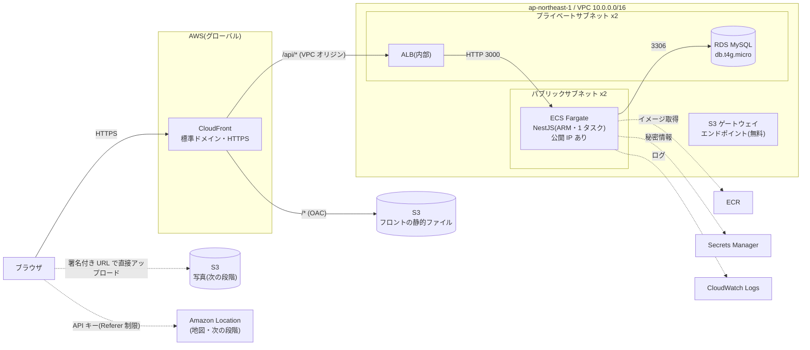

# TripDiary インフラ設計(AWS・Terraform・デプロイ)

Nov 19, 2026 · @masatsumaple-creator · v0.3(レビュー待ち。D4・D5 は承認済み)

このドキュメントは、TripDiary を AWS にデプロイするための**設計だけ**をまとめたものです。AWS への操作(Terraform の apply など)は、この文書のレビューと承認の後に、段階ごとに行います。

要件の出どころは `00_要件定義書.md`(「制約・前提条件」「コスト」)と `20_設計書.md`(「プロジェクト構成」「CI/CD」)です。Terraform の書き方は、同じ作者の RaiseTimeLine のインフラ(`infra/`)を参考にしています(参考にした点と、変えた点は「9. RaiseTimeLine との違い」)。

## 1. 先に決めたいこと(あなたの確認が必要)

「案」は、私のおすすめです。**承認がなければ、案のとおりに進めません。**

| # | 項目 | 案 | 理由・影響 |
|---|---|---|---|
| D1 | リージョン | ap-northeast-1(東京) | 要件の想定どおり。以降の見積もりも東京の単価 |
| D2 | データベース | RDS MySQL 8.4、db.t4g.micro、シングル AZ、20GB(gp3) | 費用を最小に。Multi-AZ は約 2 倍で、課題には過剰 |
| D3 | ドメイン | CloudFront の標準ドメイン(`*.cloudfront.net`) | 独自ドメインなしで HTTPS が使える(位置情報・Secure Cookie に必須)。独自ドメインにすると、ACM と Route 53 の設定が増える |
| D4 | 予算と運用(**承認済み**) | **講師の確認期間は 1 週間**。構築・確認の間は、使うときだけ作って、終わったら `terraform destroy`。**完成版を作って、一度リハーサルをして消し、提出のタイミングで作り直し、講師の確認が終わったらすぐ消す**(「10. 運用の流れ」)。予算の目安は約 $20(約 ¥3,000)で、アラートは $20 と $25 | 全体で約 $17〜19(約 ¥2,600〜2,800)。常時稼働を続けた場合は月 $62(約 ¥9,400) |
| D5 | AWS の認証情報と、実行の分担(**承認済み**) | **私が、`terraform plan / apply / destroy` を含め、できることはすべて実行する**(あなたの指示)。認証情報は、この PC のローカルの AWS プロファイル(既定)を使う。**認証情報・アカウント ID・メールアドレスは、コミットにも PR にも書かない**(リポジトリは公開されている)。守ること: ① `Project=tripdiary` のタグのリソースだけを触る(同じアカウントの `raisetimeline-*` には触らない)② 層ごとに `plan` を確認してから `apply` する。課金が始まる層(L2・L3)は、予算アラートを作ってから ③ 想定の予算(約 $20)を超えそうなら、止めて相談する ④ **`destroy` は、あなたが「終わった」と伝えてから**(最終の環境)。構築・確認の途中の環境は、その日のうちに片付ける ⑤ 費用の見積もりを超える操作や、想定外の変更が `plan` に出たときは、実行せずに報告する | 認証できること、他のリソースがないこと、このユーザーが管理者権限を持つことを確認済み(2026-11-19)。**管理者権限の長期の認証情報が、この PC にある**ため、課題の終了後に、アクセスキーを無効にするか削除することを推奨する |
| D6 | Fargate の CPU | ARM(Graviton) | x86 より約 20% 安い。ビルドは GitHub の ARM ランナー(`ubuntu-24.04-arm`)で行う |
| D7 | ダミー画面(`/mock`) | 最初のデプロイでは、地図(S-08)のダミー画面は、本番のビルドに含めない(地図の実装が終わるまで、`/map` も本番では隠す) | 本番にダミーのデータを載せないため |
| D8 | Swagger UI(`/api/docs`) | 本番では、環境変数で無効にできるようにし、既定は**無効** | 要件は「OpenAPI を公開」だが、仕様書は `docs/api/openapi.json` で見られる。本番で UI を出すかは、あなたの判断 |
| D9 | バックアップ | RDS の自動バックアップは 1 日(最小)。データは使い捨て(`destroy` で消える) | 課題の環境のため。残したいデータができたら、保持日数と最終スナップショットを見直す |
| D10 | Terraform の分け方 | **モジュールに分けず、層ごとのファイル**(`network.tf`、`rds.tf` …)にする | 環境が 1 つだけで、読みやすさを優先。`20_設計書.md` の未決事項「Terraform のモジュール分割」への回答案 |

## 2. 全体構成



- **同一オリジン**: フロントと API は、同じ CloudFront のドメインで配信する(`/api/*` だけ ALB へ転送)。CORS が不要で、リフレッシュトークンの Cookie(`Path=/api/auth`、`SameSite=Strict`)がそのまま動く。
- **NAT Gateway とインターフェイス型 VPC エンドポイントは置かない**(要件)。Fargate はパブリックサブネットに置き、公開 IP を付けて、インターネット経由で ECR・Secrets Manager・Logs へ出る。**受信は、ALB のセキュリティグループからだけ**許可するため、インターネットからは到達できない。ECR のイメージの実体は S3 にあるので、S3 のゲートウェイエンドポイント(無料)も付ける。
- **ALB は内部**(プライベートサブネット)。CloudFront から、**VPC オリジン**で接続する。ALB を公開しないので、インターネットから ALB へ直接アクセスできない。
- **DB はプライベートサブネット**に置き、アプリのセキュリティグループからの 3306 だけを許可する。

### セキュリティグループ

| 対象 | 受信 | 送信 |
|---|---|---|
| ALB | 80: CloudFront が VPC オリジンを作ったときに作られる、AWS 管理のセキュリティグループ(`CloudFront-VPCOrigins-Service-SG`)だけ | 3000: アプリ |
| アプリ(Fargate) | 3000: ALB だけ | 443: 全体(ECR・Secrets Manager・Logs)/ 3306: DB |
| DB(RDS) | 3306: アプリだけ | なし |

## 3. リソース仕様

### 3.1 ネットワーク・実行基盤・データ

| リソース | 仕様 |
|---|---|
| VPC | 10.0.0.0/16、AZ は 2 つ(`a`・`c`)。パブリック・プライベートのサブネットを各 2 つ。インターネットゲートウェイ。**プライベートのルートテーブルに、0.0.0.0/0 のルートを作らない**。S3 ゲートウェイエンドポイント |
| ECR | `tripdiary-backend`。タグは **IMMUTABLE**(git SHA を付ける)、プッシュ時スキャン、ライフサイクルは最新 10 件を保持 |
| ECS | クラスター 1 つ、サービス 1 つ(desired 1)。タスクは 0.5 vCPU / 1 GB、ARM64。ヘルスチェック猶予 60 秒。`enable_execute_command` は無効(必要なときだけ有効にする)。サービスの `task_definition` は、デプロイの CI が更新するため、Terraform では `ignore_changes` にする |
| ALB | 内部。リスナーは HTTP:80 で、全部をアプリのターゲットグループ(3000)へ。ヘルスチェックは **`/api/health/live`**(DB に依存しない。「7. アプリの変更」を参照)、間隔 30 秒、正常 2 回・異常 3 回、登録解除の待ち 30 秒 |
| RDS | MySQL 8.4、db.t4g.micro、シングル AZ、20GB gp3、暗号化、`backup_retention_period = 1`、`deletion_protection = false`、`skip_final_snapshot = true`(使い捨て)。**マスターパスワードは RDS 管理**(`manage_master_user_password = true`)で、Secrets Manager に保管され、Terraform の state に入らない。文字コードは `utf8mb4`(パラメータグループ) |
| Secrets Manager | RDS が作る DB のマスター認証情報、`JWT_SECRET`(`random_password` で生成。**state に入るため、state のバケットは暗号化して非公開**にする) |
| IAM(タスク) | **実行ロール**: ECR からの取得、ログの書き込み、上の 2 つのシークレットの取得だけ。**タスクロール**: 最初は何も付けない(写真の段階で、画像のバケットへの権限を足す) |
| CloudWatch Logs | `/ecs/tripdiary`、保持 7 日 |
| 環境変数(タスク) | `NODE_ENV=production`、`PORT=3000`、`DB_HOST`・`DB_PORT`・`DB_NAME`(平文)、`DB_USER`・`DB_PASSWORD`・`JWT_SECRET`(Secrets Manager から注入) |

### 3.2 フロントの配信

| リソース | 仕様 |
|---|---|
| S3(フロント) | 非公開。CloudFront の **OAC**(SigV4)だけが読める(バケットポリシーで、`AWS:SourceArn` をこのディストリビューションに限定) |
| CloudFront | 標準ドメイン・標準の証明書。`PriceClass_100`、`http2and3`、HTTP は HTTPS へリダイレクト |
| ビヘイビア: 既定 | S3 へ。キャッシュは `Managed-CachingOptimized`、GET/HEAD のみ |
| ビヘイビア: `/api/*` | ALB(VPC オリジン)へ。キャッシュなし(`CachingDisabled`)、オリジンリクエストは `AllViewerExceptHostHeader`(Cookie・Authorization・クエリを転送)、全メソッド |
| SPA のフォールバック | **CloudFront Function**(ビューアーリクエスト)で、拡張子のない URL を `/index.html` に書き換える。**カスタムエラーレスポンスは使わない**(`/api/*` の 403・404 まで書き換えてしまい、API のエラーが壊れるため。RaiseTimeLine で踏んだ点) |
| セキュリティヘッダー | CloudFront のレスポンスヘッダーポリシーで付与: `Strict-Transport-Security`、`X-Content-Type-Options: nosniff`、`X-Frame-Options: DENY`、`Referrer-Policy`、`Permissions-Policy`(位置情報は自分のオリジンだけ許可)。**CSP は、まず `Report-Only` で入れ**、Playwright の E2E で画面が壊れないことを確認してから本適用する(Nuxt の SPA は、起動用のインラインスクリプトがあるため、ハッシュかノンスの扱いを確認する) |
| デプロイ時のキャッシュ | `index.html` は、デプロイのたびに `/*` を無効化(invalidation)する。`_nuxt/*` は、ファイル名にハッシュが付くため、長期キャッシュのままでよい |

### 3.3 次の段階で足すもの(最初のデプロイには含めない)

| 段階 | リソース |
|---|---|
| 写真(F-04) | S3(画像用。非公開、AES256、不完全なマルチパートの 1 日後削除)、CORS(許可するオリジンは CloudFront のドメインだけ。GET・HEAD・PUT)、タスクロールに、そのバケットへの `PutObject`・`GetObject`・`DeleteObject`・`ListBucket` |
| 地図(F-16〜F-18) | Amazon Location Service の地図リソースと、**API キー**(許可する操作を地図の表示と逆ジオコーディングに限定し、**Referer を CloudFront のドメインに限定**)。AWS Budgets の通知で、利用の急増に気づけるようにする(要件の未決事項「利用上限の設定方法」への回答案: 上限で止める機能はないため、予算のアラートと、API キーの制限で守る) |

## 4. Terraform の構成

`infra/` に置く(`20_設計書.md` のプロジェクト構成どおり)。モジュールには分けず、層ごとのファイルにする(D10)。

```
infra/
├── bootstrap/main.tf        … Terraform の state 用の S3 バケット(最初に 1 回だけ。ローカル state)
├── versions.tf              … Terraform >= 1.10、aws ~> 6.0、random ~> 3.6。.terraform.lock.hcl はコミット
├── variables.tf / outputs.tf
├── network.tf               … VPC・サブネット・IGW・S3 エンドポイント・セキュリティグループ
├── ecr.tf
├── rds.tf / secrets.tf
├── alb.tf / ecs.tf / iam.tf
├── s3_frontend.tf / cloudfront.tf
├── github_oidc.tf           … デプロイ用の IAM ロール
├── budgets.tf               … 予算のアラート
├── backend.hcl.example      … state のバケット名(実際の backend.hcl は gitignore)
└── README.md                … 手順・費用・片付け(destroy)の手順
```

- **state**: S3 に保存し、`use_lockfile = true`(Terraform 1.10 以降。DynamoDB は不要)、`encrypt = true`。バケットは、バージョニング・暗号化・パブリックアクセスのブロックあり。
- **変数**: すべて既定値を持つ。`*.tfvars` はコミットしない。名前の接頭辞は `tripdiary`(S3 のように全体で一意が必要な名前には、アカウント ID を付ける)。
- **タグ**: プロバイダーの `default_tags` で、`Project=tripdiary`、`ManagedBy=terraform` を全リソースに付ける。
- **使い捨てを前提にした設定**: S3 は `force_destroy = true`、ECR は `force_delete = true`、Secrets Manager は `recovery_window_in_days = 0`(`terraform destroy` で、きれいに消せるように)。
- **`terraform destroy` の確認**: 実行後に、残っているものがないかを、AWS CLI で確認する手順を README に書く(ALB・RDS・Elastic IP・CloudWatch ログのグループ・S3・ECR)。state のバケットは最後に消す。

## 5. 費用の見積もり

### 5.1 前提と出どころ

- 単価は、**AWS が公開している料金データ(Price List の一括ファイル)の ap-northeast-1 を、2026-11-18 に取得した値**(米ドル)。Fargate・ALB・公開 IPv4・VPC エンドポイント・RDS・Secrets Manager・ECR・CloudWatch Logs・Amazon Location を確認した。
- 円への換算は、**1 ドル 150 円の仮の値**。実際のレートで変わる。
- データ転送・S3・CloudFront は、**無料枠(または少額)の範囲に収まる前提**で、見積もりに含めていない(CloudFront の無料枠の最新の条件は、AWS の公式ページで要確認)。
- ALB の LCU(従量の部分)は、軽い利用として 0.2 と仮定した。実際の利用で変わる。
- 新規の AWS アカウントでは、無料プランやクレジットが使える場合があり、実際の請求は下がる可能性がある。条件は、AWS の公式ページで要確認(この見積もりには含めない)。

### 5.2 単価

| 項目 | 東京の単価 |
|---|---|
| Fargate(ARM) | vCPU $0.04045 /時、メモリ $0.00442 /GB・時(x86 は $0.05056・$0.00553) |
| ALB | $0.0243 /時 + LCU $0.008 /LCU・時 |
| 公開 IPv4 アドレス | $0.005 /時(使用中) |
| RDS MySQL db.t4g.micro(シングル AZ) | $0.025 /時 |
| RDS ストレージ gp3 | $0.138 /GB・月 |
| Secrets Manager | $0.40 /シークレット・月 |
| CloudWatch Logs | 取り込み $0.76 /GB |
| ECR | $0.10 /GB・月 |
| Amazon Location(次の段階) | 地図タイル $0.04 /1,000 枚、逆ジオコーディング(Core)$0.50 /1,000 件 |
| 参考: VPC エンドポイント(インターフェイス型) | $0.014 /時 /個(要件で置かない) |

### 5.3 動かしている間の費用(1 時間あたり)

| 項目 | 内訳 | 1 時間 |
|---|---|---|
| Fargate | 0.5 vCPU / 1 GB、ARM、1 タスク | $0.0246 |
| ALB | 内部、LCU 0.2 と仮定 | $0.0259 |
| 公開 IPv4 | Fargate のタスク 1 つ | $0.0050 |
| RDS | db.t4g.micro、シングル AZ | $0.0250 |
| RDS ストレージ | gp3 20GB(月額を時間に割る) | $0.0038 |
| Secrets Manager | 2 件(月額を時間に割る) | $0.0011 |
| **合計** | | **$0.0854**(1 日 $2.05) |

この他に、月に約 $0.18(CloudWatch Logs 約 $0.08、ECR 約 $0.10)がかかる。

### 5.4 使い方ごとの月額

| 使い方 | 稼働時間 | 月額(米ドル) | 円の目安 |
|---|---|---|---|
| **1 回の確認** | 4 時間 | $0.52 | 約 ¥78 |
| **提出の運用(10 章)**: 構築・確認(約 30〜45 時間)+ リハーサル(約 3 時間)+ 講師の確認(1 週間 = 168 時間) | 約 200〜215 時間 | $17.2〜18.5 | 約 ¥2,580〜2,780 |
| **デモ・確認のときだけ**(週 1 回 4 時間) | 16 時間 | $1.54 | 約 ¥231 |
| 平日の日中だけ(1 日 8 時間 × 22 日) | 176 時間 | $15.21 | 約 ¥2,282 |
| 常時稼働 | 730 時間 | $62.53 | 約 ¥9,380 |
| 参考: タスクを 0 にして 1 か月放置 | ALB と RDS は課金が続く | $40.89 | 約 ¥6,134 |

- **「タスクを 0 にして止める」では、費用は大きく減らない**(ALB と RDS の課金が続くため)。使わないときは `terraform destroy` で消す(D4)。
- **ARM を使うと、Fargate は x86 より約 20% 安い**(1 時間あたり $0.0246 と $0.0308)。
- **NAT Gateway や、インターフェイス型 VPC エンドポイントを置くと、固定費が大きく増える**(エンドポイントだけで、4 つなら月に約 $41)。要件で置かないとしているのは、この理由による。

### 5.5 費用を守る仕組み

1. **使い捨て運用**: `terraform destroy` を標準の手順にする(README に、片付けの確認手順を書く)。
2. **AWS Budgets**: 予算(D4: 約 $20)を `budgets.tf` で作り、実績が **$20 と $25**(予算の 100% と 125%)に達したら、メールで通知する(**通知だけで、自動では止めない**)。
3. **タグ**: すべてのリソースに `Project=tripdiary` を付け、請求の画面で、このプロジェクトの費用だけを見られるようにする。
4. **地図**: API キーの許可する操作と Referer を絞る。利用が急に増えたら、Budgets の通知で気づく。

## 6. デプロイの流れ(CI/CD)

`20_設計書.md` の方針(手動実行・GitHub OIDC)を具体化する。`.github/workflows/deploy.yml` に置く。

- **起動**: `workflow_dispatch` のみ(手動)。入力は、バックエンド・フロント・マイグレーションを実行するかどうかの 3 つ。同時に 1 つしか動かさない(`concurrency`)。権限は `contents: read` と `id-token: write` だけ。
- **認証**: GitHub OIDC。IAM ロールの信頼は、`repo:masatsumaple-creator/app-kadai2-TripDiary:ref:refs/heads/main` の**このリポジトリの main ブランチだけ**。長期のアクセスキーは使わない。1 つの AWS アカウントに作れる GitHub の OIDC プロバイダーは 1 つだけなので、すでにある場合は、変数で作成を切り替える。
- **デプロイ用ロールの権限(最小限)**: ECR へのイメージのプッシュ(このリポジトリだけ)、ECS のタスク定義の取得・登録・サービスの更新・タスクの実行、**`iam:PassRole` は、タスクの 2 つのロールだけ**、フロントの S3 バケットへの書き込み、CloudFront の無効化(このディストリビューションだけ)。
- **バックエンド**: ARM ランナーで Docker をビルド → ECR へ(タグは git SHA)→ 現在のタスク定義のイメージだけを差し替えて、新しいリビジョンを登録 → **マイグレーション**(下記)→ `update-service` → `aws ecs wait services-stable`。
- **マイグレーション**: 同じイメージで、**1 回限りのタスク**(`aws ecs run-task`)として `prisma migrate deploy` を実行し、終了コードを確認してから、サービスを更新する。失敗したら、サービスは更新しない。起動時に毎回実行する方式にしないのは、タスクが複数になったときの競合と、起動の遅れを避けるため。
- **フロント**: `npm ci` → `nuxt generate` → `aws s3 sync --delete` → CloudFront を `/*` で無効化。
- **設定値**: GitHub のリポジトリの「変数」に置く(ロールの ARN、ECR、ECS のクラスターとサービス、S3、CloudFront の ID)。`terraform output` から手でコピーする手順を README に書く。秘密情報ではない。
- **ロールバック**: 直前のタスク定義のリビジョンを指定して、`update-service` する。マイグレーションは、**前方にだけ進める**(列の削除などは、2 段階に分ける: まず使わなくして、次のリリースで消す)。

## 7. アプリ側の変更(インフラの前に必要)

現在のコードのままではデプロイできない点。**各段階の PR で、テストとあわせて入れる**。

| # | 変更 | 理由 |
|---|---|---|
| A1 | ✅ 実装済み(PR #36)**Dockerfile を作る**(`backend/`)。マルチステージ(ビルド → 実行)、ARM64 対応、Node 24、本番の依存 + Prisma CLI、`dist/`、`prisma/`(マイグレーション)を含める。非 root で実行 | 現在はコンテナ化していない。Prisma 7 はクエリエンジンのバイナリが不要だが、マイグレーションのために CLI が要る |
| A2 | ✅ 実装済み(PR #36)**`GET /api/health/live`**(常に 200、DB に依存しない)を追加。既存の `/api/health` は、DB まで確認する診断用として残す | ALB のヘルスチェックを DB に依存させると、DB が一瞬つながらないだけで、タスクが入れ替わり続けるため(RaiseTimeLine で踏んだ点) |
| A3 | ✅ 実装済み(PR #36)**DB の接続情報を、部品から組み立てられるようにする**: `DB_HOST`・`DB_PORT`・`DB_NAME`・`DB_USER`・`DB_PASSWORD` から接続を作る(`DATABASE_URL` があれば、それを優先)。パスワードは、URL エンコードを自動で行う | ECS が注入するのは、ユーザー名とパスワードが別々の値。RDS が作るパスワードには、URL に使えない記号が含まれうる |
| A4 | ✅ 実装済み(PR #36)**グレースフルシャットダウン**(`enableShutdownHooks`)。SIGTERM で、処理中のリクエストを終えてから止まる | ECS のタスクの入れ替えで、リクエストを落とさないため |
| A5 | ✅ 実装済み(PR #36)**Swagger UI を、環境変数で無効にできる**ようにする(D8) | 本番での公開は、あなたの判断 |
| A6 | ✅ 実装済み(`HIDE_MOCK=true` でビルド)**本番のビルドから `/mock` と `/map`(ダミーの地図)を外す**(D7)。地図の実装後に戻す | 本番にダミーのデータを載せないため |
| A7 | (次の段階)**DB への TLS 接続**(RDS の CA の証明書)と、`require_secure_transport`。ログイン試行回数の制限(`trust proxy` の設定が必要) | 強化の項目。最初のデプロイの後に入れる |

## 8. 構築の段階(PR の分け方)と、あなたの確認が必要な地点

AWS の費用が発生するのは、**apply を実行したときだけ**。各段階で、コードの PR(レビュー・CI)と、apply(あなたが実行)を分ける。

| 段階 | 内容 | 費用が発生するか |
|---|---|---|
| **L0** | この設計書のレビュー。D1〜D10 の確認 | なし |
| **L1** | `infra/bootstrap`(state の S3)、`versions.tf`、`variables.tf`、`network.tf`、`ecr.tf`、`budgets.tf`。**予算のアラートを最初に作る** | VPC・ECR・予算は、ほぼ無料(IPv4 を付けるまで) |
| **L2** | `rds.tf`、`secrets.tf`。plan を確認してから apply | **RDS が課金開始**(時間あたり $0.025 + ストレージ) |
| **L3** | アプリ側の変更 A1〜A4 + `alb.tf`、`ecs.tf`、`iam.tf`。最初のイメージを ECR へ push してから、サービスを起動 | **ALB・Fargate・公開 IPv4 が課金開始** |
| **L4** | `s3_frontend.tf`、`cloudfront.tf`(レスポンスヘッダーポリシーを含む)。A5・A6 | ほぼ無料(無料枠内) |
| **L5** | `github_oidc.tf` と `deploy.yml`。マイグレーションの 1 回限りのタスク。デプロイ先への簡易 E2E(疎通の確認) | なし |
| **リハーサル** | **完成版で、何もない状態(state のバケットだけ残す)から、手順書どおりに全部作り**、デモデータを入れ、疎通確認(E2E)を通し、スクリーンショットと動画を記録して、消す。所要時間を測り、手順書を直す(10 章) | 数時間ぶん |
| **提出日** | 手順書どおりに作り直し、デモデータ・疎通確認の後、URL とデモ用アカウントを提出。講師の確認期間(1 週間)は動かしたままにし、**確認完了の連絡の後すぐ `terraform destroy`** | 約 1 週間ぶん |
| **L6〜** | 写真(S3 とタスクロール)、地図(Amazon Location と API キー)、強化(A7)。それぞれ、機能の PR と一緒に | 小さい |

- **apply の前に、必ず plan の結果(作られるリソースと、費用の影響)を共有し、あなたの承認を得る。**
- 課金が始まる L2・L3 は、**同じ日に、確認から片付けまでを完了できるように**進める。

## 9. RaiseTimeLine との違い

| 項目 | RaiseTimeLine | TripDiary(この設計) |
|---|---|---|
| 言語・DB | Spring Boot・PostgreSQL | NestJS・MySQL |
| Terraform の構成 | モジュールなし・層ごとのファイル | **同じ**(D10) |
| state | S3 + `use_lockfile`(DynamoDB なし) | **同じ** |
| ネットワーク | NAT なし・Fargate はパブリックサブネット・ALB は内部・CloudFront の VPC オリジン | **同じ** |
| SPA のフォールバック | CloudFront Function(カスタムエラーレスポンスは使わない) | **同じ** |
| マイグレーション | アプリの起動時(Flyway) | **1 回限りの ECS タスク**(失敗したらサービスを更新しない) |
| ヘルスチェック | 起動中に DB に依存しない liveness | **同じ考え方**(A2) |
| ヘルスチェックの猶予 | 180 秒(Spring Boot の起動が遅いため) | 60 秒(NestJS は速い) |
| CPU | 調査した範囲では、指定の記載なし | **ARM**(約 20% 安い。D6) |
| 予算のアラート | なし | **あり**(L1 で最初に作る) |
| セキュリティヘッダー | なし | **あり**(CSP は Report-Only から) |
| 費用の見積もり | 「1 日に数ドル」の記載のみ | 項目ごとの単価・時間あたり・使い方ごと(5 章) |
| 秘密情報 | RDS 管理のパスワード・`random_password` | **同じ** |
| デプロイ | `workflow_dispatch`・OIDC・main ブランチのみ | **同じ**(+ 1 回限りのタスクでマイグレーション) |

## 10. 運用の流れ(使い捨て)

課題の提出と、講師の確認を前提に、**環境を作り直せること**を前提にした運用にする(D4)。

### 10.1 流れ

| 順 | フェーズ | やること | 環境 |
|---|---|---|---|
| 1 | 構築(L1〜L5) | 層ごとに、コードの PR → plan の承認 → apply。**使うときだけ作り、同じ日に、確認から片付けまで終える** | 必要な時間だけ |
| 2 | 完成版 | 機能(写真・地図を含む)と、本番の設定がそろった状態 | なし |
| 3 | **フルリハーサル**(提出前に最低 1 回) | 何もない状態から、**手順書どおりに全部作る** → デモデータ投入 → 疎通確認(Playwright) → **スクリーンショットと短い動画を記録** → 消す。**所要時間を測り、手順書を直す** | 数時間 |
| 4 | **提出日** | 手順書どおりに作成(目安 30〜40 分。リハーサルで実測して更新)→ デモデータ → 疎通確認 → **URL とデモ用アカウントを提出** | 作成から |
| 5 | **講師の確認期間(1 週間)** | 動かしたままにする。Budgets のアラートを見る | 1 週間 |
| 6 | **確認完了の連絡** | **すぐ `terraform destroy`** → 残っているものがないかを AWS CLI で確認 → 請求を確認 | 消す |

- **講師の確認の終わりは、事前に講師に確認する**(終了の連絡か、日付の目安)。確認が終わる前に消さないため。目安の日付は、提出時に伝えておく。
- 残すのは、**state の S3 バケット**(数円)だけ。ほかは、すべて消す(`terraform destroy`)。

### 10.2 この運用のために、新しく必要なもの

| # | 必要なもの | 内容 |
|---|---|---|
| O1 | **手順書(runbook)** | `infra/README.md` に、「作る」「確認する」「消す」「消えたかの確認」の手順を、コマンドの順番どおりに書く。リハーサルで実測して直す |
| O2 | **デモデータの投入スクリプト** | API 経由で、架空のユーザー・投稿(エリア・公開範囲を散らす)・コメント・フォロー・いいね・マイリストを作る。講師に渡す**デモ用アカウント**も作る。**個人情報は入れない**。冪等にする(何度実行しても、同じ状態になる) |
| O3 | **GitHub 変数の自動更新** | 作り直すたびに、CloudFront のドメイン、ロール、ECR、ECS、S3 の ID が変わる。`terraform output` から `gh variable set` で更新するスクリプトにして、手作業のミスをなくす |
| O4 | **作成順序の固定** | ECR を作る → イメージを build して push → ECS のサービスを起動、の順。イメージがない状態でサービスを起動すると、タスクが失敗し続ける(RaiseTimeLine で踏んだ点) |
| O5 | **動作の記録** | スクリーンショットと短い動画(登録・投稿・いいね・コメント・フォロー・マイリスト・地図)。作り直しに失敗した場合に、提出物の代わりとして添えられるようにする |
| O6 | **片付けの確認スクリプト** | `destroy` の後に、ALB・RDS・Fargate・Elastic IP・CloudWatch のログのグループ・S3・ECR が残っていないことを、AWS CLI で確認する |

### 10.3 この運用のリスク

| リスク | 対策 |
|---|---|
| 提出日の作り直しが、予想外のエラーで失敗する | **リハーサルで潰す**(最後のリハーサルは、提出の前日までに済ませる)。AWS のサービスの上限(クォータ)や、アカウントの制限は、**事前に確認**する。失敗した場合に備えて、O5 の記録を用意する |
| 作り直すたびに、URL が変わる | 提出する URL は、提出日に作った環境のもの。O3 で、設定値の更新を自動にする |
| データが消える | 講師が作ったテストデータも、`destroy` で消える(問題なし)。デモ用アカウントの情報は、提出物に書く。リハーサルのデータは、本番の環境には引き継がない |
| 消すのが遅れて、課金が続く | 確認完了の連絡を受けたら、**その日のうちに**消す。Budgets のアラート($20・$25)で、消し忘れに気づく。消し忘れると、1 日約 $2.05 かかり続ける |
| 消すのが早すぎて、講師が確認できない | 終了の連絡(または日付)を、講師に確認する(10.1) |
| 作り直しの所要時間が、想定より長い | CloudFront と RDS の作成に、それぞれ数分〜10 分程度かかることがある。**リハーサルで実測**し、提出日は、余裕をもって始める |

## 11. リスクと注意

- **課金の止め忘れ**が最大のリスク。`terraform destroy` と、Budgets のアラートで守る。常時稼働すると月 $62 になる。
- **state に秘密情報が入る**(`JWT_SECRET`)。state のバケットは、暗号化・非公開・バージョニングを必ず有効にする。
- **公開 IP を付けた Fargate** は、セキュリティグループで ALB からの受信だけを許可していることが、安全性の前提。ここを緩めない。
- **CloudFront の標準ドメイン**は、再作成のたびに変わる。`destroy` → `apply` のたびに、ドメインと、GitHub の変数、(地図を入れたら)API キーの Referer を更新する必要がある。独自ドメイン(D3)にすると、この手間はなくなるが、設定と費用が増える。
- **RDS は `destroy` でデータが消える**(D9)。確認用のテストユーザーは、環境ごと消える前提。
- この文書の**見積もりは、確認した単価と仮定にもとづく目安**で、請求額を保証しない。実際の請求は、AWS の請求画面と Budgets で確認する。

## 12. 改訂履歴

| 版 | 日付 | 内容 |
|---|---|---|
| v0.1 | 2026-11-18 | 初版(設計のみ。レビュー待ち) |
| v0.2 | 2026-11-19 | D4(予算と運用)を承認済みに。講師の確認期間(1 週間)と、「完成版でリハーサル → 提出日に作り直し → 確認後すぐ destroy」の運用(10 章)、必要な準備(O1〜O6)、1 週間の費用の見積もりを追記 |
| v0.3 | 2026-11-19 | D5 を承認済みに(plan / apply / destroy も私が実行する。守ること①〜⑤)。**L1 を構築済み**: state のバケット、VPC・サブネット・ルート・S3 エンドポイント・セキュリティグループ、ECR、予算のアラート(25 件。課金が発生するものは含まれない)。実際の AWS で、構成を直接確認した |
| v0.4 | 2026-11-19 | **L2 を実機で確認**: RDS MySQL 8.4.11(db.t4g.micro・シングル AZ・gp3 20GB・暗号化・非公開・utf8mb4 のパラメータグループ反映済み)、RDS 管理のマスターパスワード、JWT_SECRET のシークレット(6 リソース)。確認後に同日 destroy し、RDS・シークレット・パラメータグループが残っていないことを確認した(L1 は維持)。課金は約 1 時間分未満 |
| v0.5 | 2026-11-19 | アプリ側の A1〜A5 を実装(Dockerfile、`/api/health/live`、`DB_*` から接続を組み立て、グレースフルシャットダウン、Swagger UI の切り替え)。コンテナで、マイグレーション・起動・SIGTERM での停止(終了コード 0)・本番での Swagger 無効を確認。CI にイメージのビルドと起動確認を追加。A6(`/mock`・`/map` を本番から外す)は L4、A7 は初回デプロイの後 |
| v0.6 | 2026-11-19 | **L3 を実機で確認**(L2 と合わせて 16 リソース、約 9 分で作成): ALB(内部)・ターゲットグループ(ヘルスチェック `/api/health/live`)・ECS(Fargate ARM64、0.5 vCPU / 1GB)・IAM(実行ロールは ECR・ログ・2 つのシークレットだけ)・ログ(7 日)。ARM64 のイメージを ECR へ push(約 205MB)→ マイグレーションの 1 回限りのタスクが終了コード 0(4 件適用)→ サービスが安定し、ターゲットが healthy。確認後に同日 destroy し、ECS・RDS・ALB・シークレット・ログ・ロールが残っていないことを確認(L1 と ECR は維持)。稼働は約 20 分 |
| v0.7 | 2026-11-19 | **L4 を実機で確認**(L1 以外の 26 リソース、約 13 分で作成): フロントの S3(非公開・OAC・暗号化)、CloudFront(標準ドメイン、PriceClass_100、`/api/*` は VPC オリジンで内部 ALB へ、SPA のフォールバックは CloudFront Function、セキュリティヘッダー・CSP は Report-Only)、ALB の受信ルール(VPC オリジンの管理 SG から 80 番だけ)。A6 を実装(`HIDE_MOCK=true` のビルドは `/map`・`/mock` のルートとダミーデータを含まない。CI で検査)。CloudFront 経由で、画面・SPA の直接 URL(200)・`/api/health(/live)`・登録 → ログイン → 投稿(Cookie は HttpOnly・Secure・SameSite=Strict)・Swagger UI 無効(404)・HTTP → HTTPS(301)・各ヘッダーを確認。ブラウザで画面の表示を確認(ナビに「地図」なし)。確認後に同日 destroy。**全層(L1〜L4)を通した初めての確認**。リハーサルでは、デプロイ CI(L5)で同じ流れを自動化する |
| v0.8 | 2026-11-19 | **L5 のコードを追加**: `github_oidc.tf`(GitHub OIDC プロバイダー。作成は変数で切り替え / デプロイ用ロール。信頼は、このリポジトリの `main` だけ。権限は、ECR へのプッシュ・ECS のタスク定義とサービスの更新・マイグレーションのタスクの実行・`iam:PassRole`(2 つのロールだけ、ECS タスクとしてだけ)・フロントの S3・CloudFront の無効化(このディストリビューションだけ))、`.github/workflows/deploy.yml`(手動実行。ARM ランナーでビルド → ECR(タグは git SHA)→ タスク定義の差し替え → マイグレーション(1 回限りのタスク。失敗したらサービスを更新しない)→ サービスの更新 → フロントの配置 → CloudFront の無効化 → 疎通の確認)、`scripts/set-github-variables.mjs`(O3: `terraform output` から、GitHub の変数を設定)。**実機での確認は、マージ後**(OIDC のロールの信頼が `main` だけのため、ワークフローは `main` に入れてからでないと動かせない) |
| v0.9 | 2026-11-19 | **L5 を実機で確認**(L1 以外の 29 リソースを、イメージなし(`bootstrap`)から作成。約 14 分)。変更: GitHub の OIDC トークンの `sub` が、このリポジトリでは「不変のサブジェクト」(オーナーとリポジトリの ID を使う形式)のため、最初はロールを引き受けられなかった(`Not authorized to perform sts:AssumeRoleWithWebIdentity`)。信頼条件を、変数 `github_oidc_subject_prefix`(既定は、このリポジトリの接頭辞。ID は公開情報)で切り替えられるようにして解決。確認: Deploy を実行(約 6 分)→ ARM64 イメージのビルドと ECR への push(git SHA)→ タスク定義の差し替え(リビジョン 4)→ マイグレーション 4 件 → サービスの更新(安定)→ フロントの配置・CloudFront の無効化 → 疎通確認(画面・`/api/health/live`・`/api/health`)。さらに、CloudFront 経由で、登録 → `/me` → 投稿、Swagger UI の 404、HTTP → HTTPS、ヘッダーを確認。確認後に同日 destroy(OIDC プロバイダーとロールを含む)し、残りがないことを確認。**ワークフローだけで、何もない状態から動く環境まで作れることを確認できた**。`scripts/set-github-variables.mjs` は、Windows でもシェルを経由しないように修正 |
| v0.10 | 2026-11-19 | **リハーサルの準備**: O1 運用手順書(`23_運用手順書.md`)、O2 デモデータの投入スクリプト(`scripts/seed-demo-data.mjs`。ユーザー 3・投稿 10・フォロー・いいね・コメント・マイリスト。何度実行しても重複しない。ローカルで、公開範囲が効くことまで確認)、O6 片付けの確認スクリプト(`scripts/cleanup-check.mjs`。課金されるもの 17 項目を、サービスごとに直接確認。残りがあれば終了コード 1。意図的に残して、検出できることを確認)。Dockerfile に openssl を追加(Prisma の警告の解消) |
